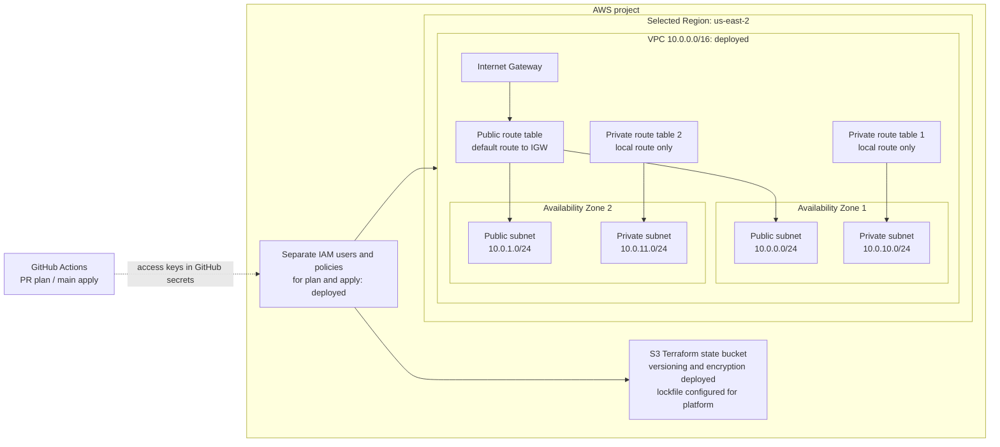

# aws-eks-platform-lab

## Overview

This is a hands-on AWS platform engineering lab built on existing GCP, GKE, Terraform, Kubernetes, and SRE experience. The long-term goal is a production-inspired EKS platform, developed in small, observable increments. The current increment defines the network foundation and the Terraform delivery path. It does **not** define or deploy EKS, EC2 nodes, a NAT Gateway, RDS, ElastiCache, or an application.

**Status:** Bootstrap has been applied: the S3 state bucket has versioning, default encryption, and public-access blocking, and separate plan/apply IAM users with policies exist. Access keys were created outside Terraform and configured as GitHub secrets by the repository owner. The first `main` workflow apply succeeded, and the VPC, four subnets across two Availability Zones, route tables, and Internet Gateway were verified in AWS. The PR plan path and GitHub environment branch restriction have not been verified. The initial bootstrap attempt failed because the project's AWS service control policy denied GitHub OIDC provider creation; the IAM user design was then applied successfully. The selected Region is `us-east-2` (Ohio). Both Terraform roots reject another Region.

## Architecture

The diagram shows **deployed and verified resources**. It will grow only when a new component is implemented.



The public subnets have an Internet Gateway route but do not automatically assign public IPv4 addresses. The private subnets have no internet egress yet. Nothing is scheduled into these subnets. IAM users are global AWS resources; the state bucket and VPC are Regional resources outside and inside the VPC respectively.

## Technology Stack

| Component | Current responsibility |
| --- | --- |
| Terraform and AWS provider | Define bootstrap resources and the platform network |
| Amazon S3 | Versioned, encrypted Terraform state with native S3 lockfiles |
| IAM and GitHub Actions secrets | Separate programmatic plan and apply identities |
| VPC, subnets, routes, Internet Gateway | Two-zone network foundation |
| GitHub Actions | Validate and plan same-repository PRs; plan and apply on `main` pushes |

## Design Decisions

- **Small first increment:** VPC, subnets, routes, and an Internet Gateway are enough to establish the network layout. NAT and the managed compute/data services are omitted until their costs and operational behavior can be reviewed separately.
- **Private subnet isolation:** Each private subnet has its own route table with only the VPC's local route. Future private nodes will need an explicit NAT or VPC endpoint design before they can pull images or call AWS services.
- **Two Availability Zones:** Terraform selects two available zones in the selected Region. This provides subnet placement options; it does not yet provide workload availability.
- **Separated privileges:** A PR plan user can read network resources and state, while the `main` apply user can modify the current network and state. The apply credential is kept in a GitHub environment restricted to `main`; the PR workflow cannot access that environment. The EC2 write policy is limited by action and Region, but uses `Resource: *` where resource IDs are unknown before creation; tightening it as resources become known is future work.
- **Credential trade-off:** The project's [managed AWS policy](https://docs.aws.amazon.com/accounts/latest/reference/scps-and-rcps-for-projects.html) denies creation of IAM identity providers, preventing GitHub OIDC. Dedicated IAM users with access keys are a Free Plan compatible fallback. Long-lived keys require rotation and careful protection. Terraform manages only the users and policies; key material never enters Terraform state.
- **State bootstrap:** The bucket and GitHub IAM users are created by a separate Terraform root using local state. The platform root uses S3 state and [native lockfiles](https://developer.hashicorp.com/terraform/language/backend/s3). Local bootstrap state must be retained securely and never committed.

The design is informed by the security, operational excellence, reliability, and cost optimization pillars of the [AWS Well-Architected Framework](https://docs.aws.amazon.com/wellarchitected/latest/framework/welcome.html). It is a lab, not a production availability claim.

## Repository Structure

```text
.github/workflows/terraform.yml     PR plan and main-branch apply
terraform/bootstrap/                Local bootstrap: S3 state and IAM users
terraform/platform/                 S3-backed VPC foundation
README.md                           Current design and runbook
.gitignore                          Excludes local state, plans, variables, and tools
```

Provider dependency locks are tracked in each Terraform root. `.terraform/`, state files, plan files, and `*.tfvars` are ignored.

## Prerequisites

- An AWS project whose selected Region is confirmed as `us-east-2`; check the project's plan and spend status in **AWS Settings → Billing**.
- Terraform 1.14 or later within major version 1, AWS CLI with an authenticated local session, and permissions to manage the bootstrap S3 bucket and programmatic IAM users/policies. IAM access keys must be created manually after bootstrap.
- GitHub repository administration to add Actions secrets, configure the `terraform-apply` environment to allow deployments **only from `main`**, and protect `main` with required PR review and a passing Terraform plan check. A push to `main` triggers apply, so branch protection is necessary if apply should occur only after merge.
- A globally unique state bucket name, supplied only as a local Terraform input.

## Bootstrap and GitHub Secrets

`terraform/bootstrap` uses local state to create the S3 bucket and two IAM users with separate policies. Supply its required variables through `TF_VAR_aws_region` and `TF_VAR_state_bucket_name` in your local shell or an ignored `*.tfvars` file. No local input file belongs in Git. **Preserve the existing local bootstrap state:** it tracks the bucket and IAM resources already created. Review every future bootstrap plan before applying it.

After authenticating locally and setting those inputs, select the authenticated AWS CLI profile in the same shell. For this checkout, `aws login --profile aws-eks-platform-lab --region us-east-2` created a working profile while the existing default access keys remained invalid:

```sh
export AWS_PROFILE=aws-eks-platform-lab
cd terraform/bootstrap
terraform init
terraform fmt -check
terraform validate
terraform plan
terraform apply
```

Retain `terraform/bootstrap/terraform.tfstate` locally, keep it out of Git, and back it up securely; it is required to manage or remove bootstrap resources. After bootstrap, create one access key for each output user (`terraform output -raw plan_user_name` and `terraform output -raw apply_user_name`) through IAM in the AWS Management Console. Do not create keys with Terraform: its state would then contain the secret access keys.

Set these **GitHub Actions repository secrets**:

| Secret name | Value to supply |
| --- | --- |
| `AWS_REGION` | The selected Region: `us-east-2` |
| `TF_STATE_BUCKET` | `terraform output -raw state_bucket_name` |
| `AWS_TF_PLAN_ACCESS_KEY_ID` | Access key ID for the plan IAM user |
| `AWS_TF_PLAN_SECRET_ACCESS_KEY` | Secret access key for the plan IAM user |

Create a [GitHub environment](https://docs.github.com/en/actions/how-tos/deploy/configure-and-manage-deployments/manage-environments) named `terraform-apply`, restrict its deployment branches to **`main` only**, and add these **environment secrets**:

| Secret name | Value to supply |
| --- | --- |
| `AWS_TF_APPLY_ACCESS_KEY_ID` | Access key ID for the apply IAM user |
| `AWS_TF_APPLY_SECRET_ACCESS_KEY` | Secret access key for the apply IAM user |

**Do not commit access key IDs, secret access keys, session tokens, Terraform state, or plan artifacts.** Store both keys only in the specified GitHub secrets and rotate them periodically. The plan user's access to state means future state values must be treated as sensitive. Delete old IAM access keys after rotation; deactivate keys immediately if exposed. GitHub environment branch restrictions are essential because a public repository's same-repository PRs can run arbitrary Terraform code with the plan credential.

## Deployment

The workflow runs `terraform fmt`, `terraform init`, and `terraform validate` before loading AWS credentials. On a same-repository PR, it initializes the S3 backend and runs a read-oriented `terraform plan`. Fork PRs are skipped because repository secrets are unavailable. On a push to `main`, the environment-restricted job creates a fresh plan and applies that exact plan file. The PR plan is reviewed evidence; it is not reused after merge because state may have changed.

For local platform inspection after bootstrap, set `TF_VAR_aws_region` and `TF_STATE_BUCKET` in your shell, then:

```sh
cd terraform/platform
terraform init -backend-config="bucket=$TF_STATE_BUCKET"
terraform fmt -check
terraform validate
terraform plan
```

Review the plan before merging. The initial `main` apply succeeded, and the expected VPC resources were verified in the selected Region. A PR plan run has not yet been tested.

## Observability & Reliability

There are no workloads or telemetry components yet. The immediate checks are Terraform plan/apply status, state locking, and inspection of the VPC, subnet, route table, and Internet Gateway configuration. Future EKS and application increments will add CloudWatch metrics and logs, Container Insights, health/readiness probes, actionable alarms, and a dashboard; each will appear in the architecture diagram only when implemented.

## Failure Scenarios

| Future experiment | Intended observation |
| --- | --- |
| Block RDS connectivity | Application timeout behavior and database connection alarms |
| Make Valkey unavailable | Cache dependency handling and safe degradation |
| Terminate a pod | Readiness, replacement, and request continuity |
| Disrupt a node | Rescheduling across zones and available capacity |

No experiments or recovery results are claimed yet.

## Security Considerations

The state bucket blocks public access, enables versioning and default SSE-S3 encryption, and uses a native lockfile. The plan user can read state and acquire/release its lock but cannot write the state object or mutate the VPC; the apply user can do both. The apply credential must remain in the `terraform-apply` GitHub environment with a `main`-only deployment rule. Same-repository PR code still runs with read access to state, so review Terraform and provider changes carefully before opening or updating a PR. The IAM users have no console passwords.

Later services will require separate workload IAM roles, security groups, private database/cache endpoints, secret management, encryption choices, and an EKS API access policy. No database credentials or AWS tokens should be passed through Terraform variables or committed files. Terraform state may contain sensitive values even when CLI output is redacted.

## Cost Considerations

This increment does not create EKS, EC2, NAT, RDS, ElastiCache, or a load balancer. S3 state storage and requests can incur charges; network traffic and future public IPv4 use may also be charged. The full target architecture must **not** be assumed to fit within Free Tier benefits. Check the project's eligibility, budget, and current AWS prices before enabling each billable component. A free-plan project may also have service restrictions; a successful plan does not prove that a service can be created.

## Teardown

Before destroying the platform, review a destroy plan from `terraform/platform` using the same S3 backend and Region, then run `terraform destroy` only when its resources are no longer needed. Check the selected Region for remaining VPC resources. Disable and delete both IAM access keys before destroying bootstrap **last**, after the platform state is empty and no workflow needs the users. Its S3 bucket has `force_destroy = false`; retain a secure copy of state as needed and deliberately remove all object versions and lockfiles before deleting the bucket. Verify in AWS Settings → Billing that charges have stopped.

## Future Improvements

The next architecture changes can add an egress design, security groups, EKS managed node groups, Pod Identity, PostgreSQL, Valkey, the FastAPI workload, ingress, and CloudWatch telemetry. Production-grade options include per-zone NAT, Multi-AZ data services, VPC endpoints, autoscaling, and tested alerts. Each addition should have an explicit cost and failure-mode review before apply.

## Lessons Learned

The first bootstrap apply showed that the new AWS experience's managed service control policy can block an IAM API even when the signed-in role otherwise has broad permissions. The Free and Paid project policies both deny IAM identity-provider operations; upgrading to Paid alone would not enable GitHub OIDC. Terraform retained the S3 resources created before the failure in local bootstrap state. Future entries will compare VPC CNI with GKE networking, EKS control-plane responsibilities, IAM and Pod Identity with Workload Identity, security-group boundaries, managed-service failover, and the actual operational cost of a small Kubernetes lab.
