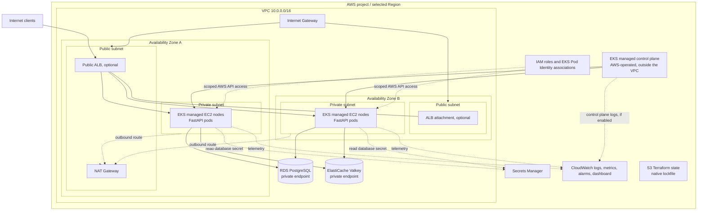

# aws-eks-platform-lab

## Overview

This repository is a hands-on AWS platform engineering lab. It applies experience with GCP, GKE, Terraform, Kubernetes, GitOps, and observability to an AWS-native design: a private EKS data plane, managed PostgreSQL and Valkey, scoped workload identities, and measurable operational behavior. The aim is to understand the AWS networking, security, service, and cost decisions behind the platform, not merely to create a cluster.

**Status:** design only. The repository does not yet contain Terraform, application code, Kubernetes manifests, or a deployed environment. The architecture and workflows below are intended targets, not verified implementation. This is a learning environment, not a production system.

The intended Region is `us-east-1`, subject to the project's assigned Region. Before implementation, confirm it in **AWS Settings → View all projects → Overview → Additional Info → Region**; all Regional resources must use that selected Region. The planned VPC CIDR is `10.0.0.0/16`.

## Architecture



The ALB and its controller are optional. If implemented, the ALB spans public subnets in both Availability Zones; the controller runs in EKS, while the ALB is an AWS-managed resource attached to the VPC. The EKS control plane is AWS-operated outside the VPC and communicates with nodes through network interfaces in the VPC; managed node group EC2 instances and application pods run in private subnets. RDS and ElastiCache are AWS-managed services with private network endpoints in the VPC, not pods on the nodes. The single NAT Gateway shown is a **lab cost choice** and an egress dependency on one Availability Zone.

## Technology Stack

| Technology | Planned responsibility |
| --- | --- |
| VPC, subnets, routes, security groups, Internet Gateway, NAT Gateway | Network segmentation and outbound access |
| Amazon EKS and EC2 managed node groups | Managed Kubernetes control plane and private worker nodes |
| IAM and EKS Pod Identity | Scoped AWS API permissions for controllers and workloads |
| Amazon RDS for PostgreSQL | Managed relational database |
| Amazon ElastiCache for Valkey | Managed cache |
| AWS Secrets Manager | Database credential storage and retrieval |
| Amazon CloudWatch and Container Insights | Logs, infrastructure and container telemetry, alarms, dashboard |
| Amazon S3 and Terraform | Remote state and declarative infrastructure provisioning |
| Python, FastAPI, Docker, Kubernetes | Sample API, container image, workload deployment |
| AWS Load Balancer Controller and ALB | Optional public HTTP ingress |

## Design Decisions

- **Private workloads:** Nodes, RDS, and ElastiCache have no public endpoint. Public subnets are reserved for internet-facing components and NAT. Private nodes need an egress path for image pulls and AWS APIs, through NAT or suitable VPC endpoints.
- **Two Availability Zones:** Node placement spans both zones to exercise scheduling and node failure behavior. A subnet group spanning zones does not make a single RDS instance or cache node highly available; Multi-AZ database deployment and cache replication/failover are separate decisions.
- **Explicit network access:** Separate security groups restrict database and cache ports to approved workload network paths. A shared node security group alone may permit every pod on that node to connect; stronger per-workload isolation requires an appropriate pod networking and policy design.
- **Managed services:** EKS, RDS, and ElastiCache reduce undifferentiated control-plane, database, and cache operations while leaving patching choices, configuration, backups, failover design, and cost management to the operator.
- **Workload identity:** [EKS Pod Identity](https://docs.aws.amazon.com/eks/latest/userguide/pod-identities.html) associates an IAM role with a Kubernetes service account for AWS API access. Database authentication remains a separate credential concern. The Pod Identity Agent is required on nodes.
- **Repeatable changes:** Terraform will own AWS infrastructure; Kubernetes deployment will be a separate stage. S3 state will use [native lockfiles](https://developer.hashicorp.com/terraform/language/backend/s3), versioning, encryption, and restricted access. The state bucket must exist before backend initialization.
- **Operational visibility:** CloudWatch telemetry should answer whether infrastructure is healthy, whether requests succeed, and where failures begin. Observability resources and retention must be sized for a short-lived lab.

These choices follow the security, reliability, operational excellence, and cost optimization concerns of the [AWS Well-Architected Framework](https://docs.aws.amazon.com/wellarchitected/latest/framework/welcome.html). Two-zone node placement, a single NAT Gateway, and potentially single-instance data services should not be mistaken for end-to-end production availability.

## Repository Structure

Current project content is documentation and repository guidance only; there are no Terraform or workload files. A possible structure as implementation proceeds is:

```text
README.md                 # current: project design and operating guide
.gitignore                # current: local ignore rules
terraform/                # planned: root configuration and backend
  modules/                # planned: reusable modules where useful
app/                      # planned: FastAPI source and Dockerfile
kubernetes/               # planned: workload and service manifests
.github/workflows/         # optional: CI/CD after the local path works
```

The final layout and commands will be updated alongside actual files.

## Prerequisites

- An AWS project with the selected Region confirmed in AWS Settings. Check whether the project is on a free or paid plan and review spend status under **AWS Settings → Billing** before provisioning.
- AWS CLI with an authenticated project session; Terraform, `kubectl`, and Docker installed locally.
- Permissions to manage the planned VPC, EC2, EKS, IAM service roles and Pod Identity, RDS, ElastiCache, Secrets Manager, CloudWatch, and S3 resources, including state bucket access. Scope permissions to the resources and actions needed as the Terraform design becomes concrete.
- An explicit cost budget and a teardown window. This architecture should be assumed billable even if the project has Free Tier benefits or credits.

## Deployment

**Not runnable yet:** there is no Terraform root module, backend configuration, cluster name, container image, or Kubernetes manifest in this repository. The expected sequence, once those files exist, is:

1. Confirm the selected Region and project plan; establish a cost budget. Create the S3 state bucket and its access controls before initializing the Terraform backend.
2. From the future Terraform root, run `terraform init`, inspect `terraform plan`, then run `terraform apply` after reviewing the proposed resources and cost exposure. Record the exact configuration, module versions, and required inputs in this section when implemented.
3. Configure `kubectl` using `aws eks update-kubeconfig` with the actual cluster name and selected Region from the deployed infrastructure. Confirm node readiness before deploying workloads.
4. Build and publish the FastAPI image to an approved registry, then apply the actual manifests or deployment workflow that will be added under `kubernetes/`. Verify rollout, readiness, database/cache connectivity, and, if enabled, ALB routing.

Infrastructure provisioning and Kubernetes workload deployment are distinct steps. A successful `terraform apply` alone will not demonstrate a working application.

## Observability & Reliability

The planned baseline includes EKS/node health, pod restarts and readiness, CPU and memory, RDS connections and storage, ElastiCache health, and request rate, latency, and error rate for the API. Container Insights and centralized application logs should feed a small CloudWatch dashboard and alarms for actionable conditions such as unavailable workloads, sustained API errors, database pressure, and failing cache nodes. Enable EKS control plane logs selectively and set log retention deliberately.

The application should expose health and readiness endpoints. Liveness should indicate whether the process can recover; readiness should reflect whether it can serve the intended request path. Exact thresholds, dashboards, and alarm behavior will be documented after they exist and are exercised.

## Failure Scenarios

| Experiment | What it should demonstrate |
| --- | --- |
| Block or misconfigure RDS connectivity | Readiness and request errors, bounded connection timeouts, and useful database alarms/logs |
| Make Valkey unavailable | Cache error handling and whether the API can degrade safely or must fail requests |
| Terminate a pod | Deployment replacement, probe behavior, and continuity during a rollout or restart |
| Drain or disrupt a node | Rescheduling across zones, capacity limits, and the effect of disruption on requests |

These are proposed experiments. Results, recovery times, and availability claims will be recorded only after testing.

## Security Considerations

- Use least-privilege IAM for Terraform, EKS components, and each service account; prefer short-lived identity over static AWS access keys. GitHub Actions, if added, should use OIDC with a restricted trust policy.
- Keep RDS and ElastiCache private and allow only required ports from approved sources. Add Kubernetes network policy or pod-level isolation where a shared node security group is too broad.
- Store database credentials in Secrets Manager and avoid committing them, putting them in Terraform variables or outputs, or embedding them in images. If Terraform ever creates a secret value, treat the state as sensitive because it may contain that value. Pod Identity grants AWS API access; it does not itself inject a database password.
- Encrypt state, database, cache, logs, and traffic where supported; restrict state bucket access and retain recoverable state versions. Define who can reach the EKS API endpoint before deployment.
- Review image provenance, pinned versions, and container permissions as the application is added.

## Cost Considerations

This target architecture **cannot be assumed to stay within the Free Tier**. [EKS cluster time and worker resources](https://docs.aws.amazon.com/eks/latest/userguide/what-is-eks.html), EC2 nodes and their storage, NAT Gateway time and traffic, RDS, ElastiCache, and optional ALB can all create ongoing charges. CloudWatch ingestion, retained logs, Container Insights, alarms, dashboards, and Secrets Manager may add charges; data transfer and public IPv4 usage may also matter. Check current service pricing and project eligibility before every deployment; no exact cost is claimed here.

Use a short deployment window, small nonproduction capacity, intentional log retention, and a reviewed Terraform plan. Check spend status in AWS Settings → Billing, set a budget where available, and destroy the lab after experiments. Reducing replicas may lower EC2 usage but does not remove fixed cluster, NAT, or managed-service charges. A single NAT Gateway reduces cost relative to one per zone but weakens egress availability.

## Teardown

When implementation exists, remove Kubernetes resources that create external load balancers before destroying their supporting VPC resources. From the Terraform root, review a `terraform plan -destroy` and run `terraform destroy` using the same backend and inputs used to create the stack. Handle retained snapshots and deletion protection deliberately; do not discard data or the state bucket until the destroy result is confirmed.

Verify in the AWS Management Console, in the selected Region, that EKS clusters and node groups, EC2 instances and volumes, load balancers, NAT Gateways, RDS instances and snapshots, ElastiCache resources, and billable CloudWatch resources are gone. Check for remaining public IPv4 addresses and other resources created outside Terraform. Remove the S3 state bucket only after confirming that no managed resources remain and state is no longer needed, then review AWS Settings → Billing for residual charges.

## Future Improvements

- Multi-AZ RDS, cache replication/failover, and one NAT Gateway per zone for a stronger availability model.
- HPA and node autoscaling with observed scaling behavior and capacity limits.
- VPC endpoints to reduce dependency on NAT for selected AWS service traffic.
- GitHub Actions CI/CD with AWS OIDC, separate plan and apply permissions, and explicit deployment approval.
- Deeper monitoring: service-level objectives, traces, synthetic checks, and tested alert routing.

## Lessons Learned

This section will collect findings from actual deployments and experiments: VPC CNI and subnet IP allocation versus GKE networking, EKS control-plane and node responsibilities versus GKE, Pod Identity versus GCP Workload Identity, AWS security-group boundaries, managed-service availability behavior, CloudWatch trade-offs, and the operational cost of a small Kubernetes lab. Findings will include the configuration tested and the observed result; there are no findings to report yet.
