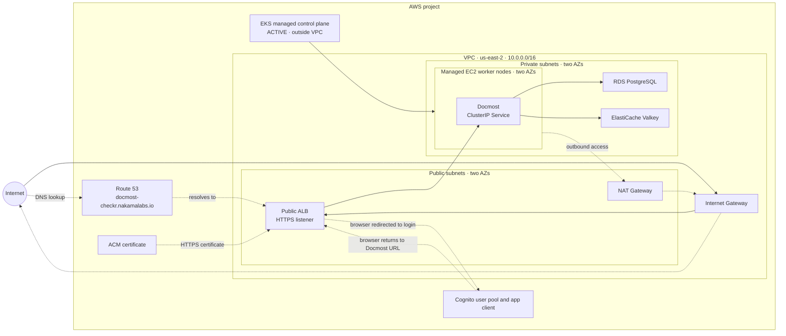

# aws-eks-platform-lab

## Overview

This is my hands-on AWS lab. My cloud experience is mainly with GCP and GKE; here I am applying that background to learn AWS by building and operating an EKS platform with Terraform. The lab runs in `us-east-2` (Ohio).

**Running now:** A VPC across two Availability Zones, EKS with private worker nodes, single-instance RDS PostgreSQL and ElastiCache Valkey, and [Docmost](deploy/docmost/README.md) behind a public HTTPS ALB with Route 53 DNS and Cognito login. Terraform uses S3 state; GitHub Actions plans pull requests and applies after merge. This is a learning environment, not a production platform.

## Architecture

RDS and Valkey each run as a single instance/node; the diagram does not imply high availability.



The ALB redirects unauthenticated browsers to Cognito. After sign-in, the browser returns to the Docmost hostname, which Route 53 resolves to the ALB.

The ALB sits in public subnets. Private worker nodes reach the internet through one NAT Gateway. RDS and Valkey remain inside the VPC; the AWS-managed EKS control plane, S3 state bucket, and Secrets Manager are outside it.

## Technology Stack

| Component | Current responsibility |
| --- | --- |
| Terraform and AWS provider | Define bootstrap resources and platform infrastructure, including the EKS service-linked-role permission and private-node egress |
| Amazon S3 | Versioned, encrypted Terraform state with native S3 lockfiles |
| IAM and GitHub Actions secrets | Separate programmatic plan and apply identities |
| VPC, subnets, routes, Internet Gateway | Two-zone network foundation |
| Amazon EKS and EC2 managed node groups | Kubernetes control plane and private worker nodes across two Availability Zones |
| AWS Load Balancer Controller | Deployed with Pod Identity; reconciles the public ALB for Docmost's Ingress |
| Route 53, ACM, and Cognito | DNS, HTTPS certificate, and sign-in for the public Docmost endpoint |
| Amazon RDS for PostgreSQL | Private, encrypted single-instance application database |
| Amazon ElastiCache for Valkey | Private, encrypted single-node application cache with TLS and AUTH |
| GitHub Actions | Validate and fingerprint same-repository PR plans; compare and apply after merge |
| Helm and Kustomize | Docmost deployment and local-secret preflight |

## Design Decisions

- **Lab egress:** One NAT Gateway in a public subnet provides outbound access for private resources. This keeps the node groups private but creates a single-AZ egress dependency and ongoing hourly and data-processing charges; it is a lab cost choice, not a production availability design.
- **Private subnet isolation:** Each private subnet has its own route table. The default route points to the NAT Gateway, so private resources can reach external services without public IPs while remaining inaccessible to unsolicited inbound internet traffic.
- **Two Availability Zones:** Terraform selects two available zones in the selected Region and runs one managed node group in each. The database and cache subnet groups span both zones, but each service currently runs only one instance/node. Docmost has one replica and temporary upload storage, so this does not establish workload availability.
- **Separated privileges:** A PR plan user can read network resources and state, while the `main` apply user can modify the platform and state. The apply credential is kept in a GitHub environment restricted to `main`; the PR workflow cannot access that environment. EKS service-linked-role creation is constrained to the EKS and EKS node group service names. Some EC2 write actions use `Resource: *` where resource IDs are unknown before creation and are scoped by action and Region.
- **Credential trade-off:** The project's [managed AWS policy](https://docs.aws.amazon.com/accounts/latest/reference/scps-and-rcps-for-projects.html) denies creation of IAM identity providers, preventing GitHub OIDC. Dedicated IAM users with access keys are a Free Plan compatible fallback. Long-lived keys require rotation and careful protection. Terraform manages only the users and policies; key material never enters Terraform state.
- **State bootstrap:** The bucket and GitHub IAM users are created by a separate Terraform root using local state. The platform root uses S3 state and [native lockfiles](https://developer.hashicorp.com/terraform/language/backend/s3). Local bootstrap state must be retained securely and never committed.

The design draws on the [AWS Well-Architected Framework](https://docs.aws.amazon.com/wellarchitected/latest/framework/welcome.html). This is a learning lab, not a production availability claim.

## Run This Repository

Run these commands from the repository root. Use Terraform 1.14 or newer 1.x, AWS CLI, and an authenticated AWS profile for `us-east-2`. Keep Terraform inputs in ignored `*.tfvars` files or your shell; keep credentials in your AWS profile or GitHub secrets. `.gitignore` also excludes Terraform state, plans, Docmost's `runtime.env`, and `values.local.yaml`.

1. **First-time bootstrap only:** `terraform/bootstrap` creates the S3 state bucket and GitHub plan/apply IAM users. Set `TF_VAR_aws_region` and `TF_VAR_state_bucket_name` locally, then run:

   ```sh
   terraform -chdir=terraform/bootstrap init
   terraform -chdir=terraform/bootstrap plan
   terraform -chdir=terraform/bootstrap apply
   ```

   Preserve `terraform/bootstrap/terraform.tfstate` securely; it is local state needed to manage the bootstrap resources. If bootstrap has already been done, skip this step and use its existing state and bucket.

2. **Configure GitHub Actions once:** create access keys for the bootstrap plan and apply IAM users in the AWS Management Console. Add repository secrets `AWS_REGION`, `TF_STATE_BUCKET`, `AWS_TF_PLAN_ACCESS_KEY_ID`, `AWS_TF_PLAN_SECRET_ACCESS_KEY`, `EKS_API_ALLOWED_CIDRS`, and `DOCMOST_VALKEY_AUTH_TOKEN`. Add the apply access key secrets `AWS_TF_APPLY_ACCESS_KEY_ID` and `AWS_TF_APPLY_SECRET_ACCESS_KEY` to a `terraform-apply` environment restricted to `main`. Protect `main` with required pull requests and the `plan` check. Never commit the keys or tokens.

3. **Existing platform:** the platform uses the S3 bucket from bootstrap. For local Terraform work, configure `AWS_PROFILE`, `AWS_REGION`, `TF_VAR_aws_region`, `TF_STATE_BUCKET`, `TF_VAR_eks_api_allowed_cidrs`, and `TF_VAR_docmost_valkey_auth_token` in your environment or ignored local inputs. Then run:

   ```sh
   terraform -chdir=terraform/platform init -backend-config="bucket=$TF_STATE_BUCKET"
   terraform -chdir=terraform/platform plan
   ```

   Review the plan before applying. In the normal workflow, opening or updating a same-repository pull request runs the plan; merging to `main` triggers a fresh plan and applies only if its changes match the reviewed PR plan.

4. **Docmost install or update:** follow the [Docmost deployment guide](deploy/docmost/README.md) for the database bootstrap, AWS Load Balancer Controller, local runtime secret, Kustomize preflight, and Helm install/upgrade commands. It also covers regenerating the ignored Cognito values overlay after Terraform changes.
