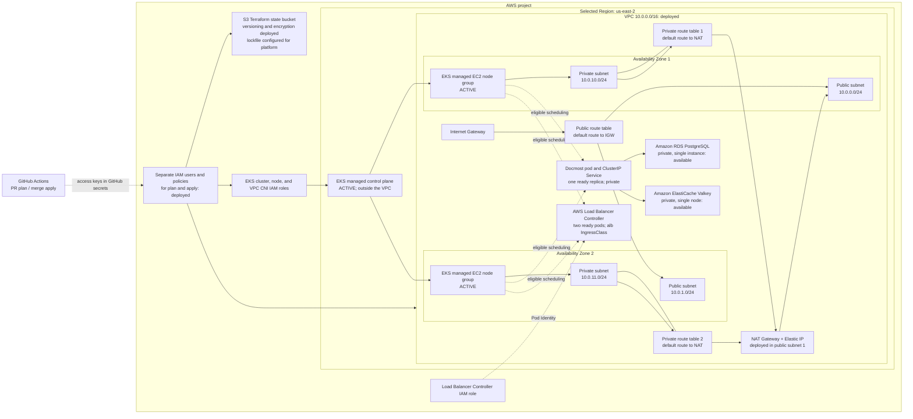

# aws-eks-platform-lab

## Overview

This is a hands-on AWS platform engineering lab built on existing GCP, GKE, Terraform, Kubernetes, and SRE experience. It develops a production-inspired EKS platform in small, observable increments. The selected Region is `us-east-2` (Ohio).

**Status:** The VPC, two public and two private subnets, Internet Gateway, NAT Gateway, EKS control plane, and one managed node group in each Availability Zone are running. The EKS cluster and both node groups were verified `ACTIVE` in AWS. Private RDS PostgreSQL and ElastiCache Valkey were applied locally and verified `available` in AWS. The S3 state bucket and separate GitHub Actions plan/apply IAM identities are also in place. The AWS Load Balancer Controller has two ready pods and an `alb` IngressClass. [Docmost](deploy/docmost/README.md) is deployed with one ready replica and an internal `ClusterIP` Service; its Ingress manifest is prepared but no public ALB exists yet. GitHub OIDC is unavailable because the project's service control policy denies IAM identity-provider creation, so Actions currently uses access keys stored in GitHub secrets.

## Architecture

The diagram shows resources applied and verified so far. Each data service currently runs a single instance/node in a private subnet; its subnet group spans both Availability Zones, but the service itself is not highly available.



The public subnets have an Internet Gateway route and load balancer discovery tags but do not automatically assign public IPv4 addresses. The NAT Gateway resides in public subnet 1 and provides outbound internet access to both private subnets; it does not allow unsolicited inbound connections. The EKS control plane is AWS-managed outside the VPC, while its worker nodes and the managed data services use private subnets. IAM users and roles are global AWS resources; the state bucket is Regional and outside the VPC. RDS stores its generated master password in AWS Secrets Manager, which is a Regional managed service outside the VPC.

## Technology Stack

| Component | Current responsibility |
| --- | --- |
| Terraform and AWS provider | Define bootstrap resources and platform infrastructure, including the EKS service-linked-role permission and private-node egress |
| Amazon S3 | Versioned, encrypted Terraform state with native S3 lockfiles |
| IAM and GitHub Actions secrets | Separate programmatic plan and apply identities |
| VPC, subnets, routes, Internet Gateway | Two-zone network foundation |
| Amazon EKS and EC2 managed node groups | Kubernetes control plane and private worker nodes across two Availability Zones |
| AWS Load Balancer Controller | Deployed with Pod Identity; will reconcile an ALB when Docmost's Ingress is applied |
| Amazon RDS for PostgreSQL | Private, encrypted single-instance application database |
| Amazon ElastiCache for Valkey | Private, encrypted single-node application cache with TLS and AUTH |
| GitHub Actions | Validate and fingerprint same-repository PR plans; compare and apply after merge |
| Helm and Kustomize | Docmost deployment and local-secret preflight |

## Design Decisions

- **Lab egress:** One NAT Gateway in a public subnet provides outbound access for private resources. This keeps the node groups private but creates a single-AZ egress dependency and ongoing hourly and data-processing charges; it is a lab cost choice, not a production availability design.
- **Private subnet isolation:** Each private subnet has its own route table. The default route points to the NAT Gateway, so private resources can reach external services without public IPs while remaining inaccessible to unsolicited inbound internet traffic.
- **Two Availability Zones:** Terraform selects two available zones in the selected Region and runs one managed node group in each. The database and cache subnet groups span both zones, but each service currently runs only one instance/node. Docmost has one replica and temporary upload storage, so this does not establish workload availability.
- **Separated privileges:** A PR plan user can read network resources and state, while the `main` apply user can modify the platform and state. The apply credential is kept in a GitHub environment restricted to `main`; the PR workflow cannot access that environment. EKS service-linked-role creation is constrained to the EKS and EKS node group service names. Some EC2 write actions use `Resource: *` where resource IDs are unknown before creation and are scoped by action and Region.
- **Credential trade-off:** The project's [managed AWS policy](https://docs.aws.amazon.com/accounts/latest/reference/scps-and-rcps-for-projects.html) denies creation of IAM identity providers, preventing GitHub OIDC. Dedicated IAM users with access keys are a Free Plan compatible fallback. Long-lived keys require rotation and careful protection. Terraform manages only the users and policies; key material never enters Terraform state.
- **State bootstrap:** The bucket and GitHub IAM users are created by a separate Terraform root using local state. The platform root uses S3 state and [native lockfiles](https://developer.hashicorp.com/terraform/language/backend/s3). Local bootstrap state must be retained securely and never committed.

The design is informed by the security, operational excellence, reliability, and cost optimization pillars of the [AWS Well-Architected Framework](https://docs.aws.amazon.com/wellarchitected/latest/framework/welcome.html). It is a lab, not a production availability claim.

## Repository Structure

```text
.github/workflows/terraform.yml     PR plan and merge-only apply
.github/scripts/terraform_plan_review.py  Plan fingerprint and merge checks
terraform/bootstrap/                Local bootstrap: S3 state and IAM users
terraform/platform/                 S3-backed VPC, EKS, RDS, and ElastiCache
deploy/docmost/                      Helm chart and Kustomize secret preflight
README.md                           Current design and runbook
.gitignore                          Excludes local state, plans, variables, and tools
```

Provider dependency locks are tracked in each Terraform root. `.terraform/`, state files, plan files, and `*.tfvars` are ignored.

## Prerequisites

- An AWS project whose selected Region is confirmed as `us-east-2`; check the project's plan and spend status in **AWS Settings → Billing**.
- Terraform 1.14 or later within major version 1, AWS CLI with an authenticated local session, and permissions to manage the bootstrap S3 bucket and programmatic IAM users/policies. IAM access keys must be created manually after bootstrap.
- GitHub repository administration to add Actions secrets, configure the `terraform-apply` environment to allow deployments **only from `main`**, and protect `main` with a ruleset requiring a pull request and the `plan` check. Require the branch to be up to date before merge and avoid routine bypasses. The workflow cannot block a direct Git push by itself.
- A globally unique state bucket name, supplied only as a local Terraform input.

## Bootstrap and GitHub Secrets

`terraform/bootstrap` uses local state to create the S3 bucket and two IAM users with separate policies. Supply its required variables through `TF_VAR_aws_region` and `TF_VAR_state_bucket_name` in your local shell or an ignored `*.tfvars` file. No local input file belongs in Git. **Preserve the existing local bootstrap state:** it tracks the bucket and IAM resources already created. Review every future bootstrap plan before applying it.

After authenticating locally and setting those inputs, select the authenticated AWS CLI profile in the same shell. For this checkout, `aws login --profile aws-eks-platform-lab --region us-east-2` created a working profile while the existing default access keys remained invalid:

```sh
export AWS_PROFILE=aws-eks-platform-lab
export AWS_REGION=us-east-2
cd terraform/bootstrap
terraform init
terraform fmt -check
terraform validate
terraform plan
terraform apply
```

Retain `terraform/bootstrap/terraform.tfstate` locally, keep it out of Git, and back it up securely; it is required to manage or remove bootstrap resources. After bootstrap, create one access key for each output user (`terraform output -raw plan_user_name` and `terraform output -raw apply_user_name`) through IAM in the AWS Management Console. Do not create keys with Terraform: its state would then contain the secret access keys.

Set these **GitHub Actions repository secrets**:

| Secret name | Value to supply |
| --- | --- |
| `AWS_REGION` | The selected Region: `us-east-2` |
| `TF_STATE_BUCKET` | `terraform output -raw state_bucket_name` |
| `AWS_TF_PLAN_ACCESS_KEY_ID` | Access key ID for the plan IAM user |
| `AWS_TF_PLAN_SECRET_ACCESS_KEY` | Secret access key for the plan IAM user |
| `EKS_API_ALLOWED_CIDRS` | JSON list containing your current public IPv4 address in `/32` CIDR notation |
| `DOCMOST_VALKEY_AUTH_TOKEN` | A newly generated, 16–128 character Valkey AUTH token; a 64-character random hexadecimal value is suitable |

Create a [GitHub environment](https://docs.github.com/en/actions/how-tos/deploy/configure-and-manage-deployments/manage-environments) named `terraform-apply`, restrict its deployment branches to **`main` only**, and add these **environment secrets**:

| Secret name | Value to supply |
| --- | --- |
| `AWS_TF_APPLY_ACCESS_KEY_ID` | Access key ID for the apply IAM user |
| `AWS_TF_APPLY_SECRET_ACCESS_KEY` | Secret access key for the apply IAM user |

**Do not commit access key IDs, secret access keys, session tokens, Terraform state, or plan artifacts.** Store both keys only in the specified GitHub secrets and rotate them periodically. The plan user's access to state means future state values must be treated as sensitive. Delete old IAM access keys after rotation; deactivate keys immediately if exposed. GitHub environment branch restrictions are essential because a public repository's same-repository PRs can run arbitrary Terraform code with the plan credential.

## Deployment

The workflow runs `terraform fmt`, `terraform init`, `terraform validate`, and the plan-guard unit tests before loading AWS credentials. On a same-repository PR, it creates a saved plan, prints the reviewable plan in the job log, and uploads only hashes for planned resource and output changes, deferred changes, and checks, plus the source tree and backend identity. Refreshed no-op values and observed drift are excluded because Terraform does not apply them. Sensitive planned values participate in the hashes but are never written to the artifact or diagnostic output. Fork PRs fail before loading AWS credentials. A push to protected `main` starts the environment-restricted job, which checks that the commit is a merged same-repository PR, finds its successful PR plan artifact for the exact source tree, creates a fresh plan, and applies it only if each actionable-section hash matches. A changed configuration, backend, planned action, output, deferred action, or check blocks apply and requires another PR plan. The ruleset prevents direct pushes to `main`; the merge check also prevents apply if that protection is bypassed.

The binary plan is never uploaded to this public repository: [Terraform warns](https://developer.hashicorp.com/terraform/cli/commands/plan) that saved plans may contain unredacted sensitive values. A GitHub ruleset targeting `main` must enforce **Require a pull request before merging** and **Require status checks to pass** with the `plan` job selected. Configure this in **Settings → Rules → Rulesets**, and verify the rule is active before relying on it.

For local platform inspection after bootstrap, set `AWS_PROFILE`, `AWS_REGION`, `TF_VAR_aws_region`, and `TF_STATE_BUCKET` in your shell. A local plan also needs `TF_VAR_eks_api_allowed_cidrs` and `TF_VAR_docmost_valkey_auth_token` supplied securely; do not put either value in a tracked file. Then:

```sh
cd terraform/platform
terraform init -backend-config="bucket=$TF_STATE_BUCKET"
terraform fmt -check
terraform validate
terraform plan
```

Review the plan before merging. The data services were applied locally; Docmost and the AWS Load Balancer Controller were deployed separately using the [Helm and Kustomize instructions](deploy/docmost/README.md). The public ALB has not been created; the Docmost Ingress still needs to be applied.

## Observability & Reliability

Docmost has startup, readiness, and liveness probes, but no dedicated telemetry components are deployed yet. Current checks include Terraform plan/apply status, state locking, EKS cluster and node-group status, Docmost pod readiness, and inspection of the VPC routes. Future increments will add CloudWatch metrics and logs, Container Insights, actionable alarms, and a dashboard; each will appear in the architecture diagram only when implemented.

## Failure Scenarios

| Future experiment | Intended observation |
| --- | --- |
| Block RDS connectivity | Application timeout behavior and database connection alarms |
| Make Valkey unavailable | Cache dependency handling and safe degradation |
| Terminate a pod | Readiness, replacement, and request continuity |
| Disrupt a node | Rescheduling across zones and available capacity |

No experiments or recovery results are claimed yet.

## Security Considerations

The state bucket blocks public access, enables versioning and default SSE-S3 encryption, and uses a native lockfile. The plan user can read state and acquire/release its lock but cannot write the state object or mutate the VPC; the apply user can do both. The apply credential must remain in the `terraform-apply` GitHub environment with a `main`-only deployment rule. Same-repository PR code still runs with read access to state, so review Terraform and provider changes carefully before opening or updating a PR. The IAM users have no console passwords.

The deployed data services use separate security groups, private endpoints, encryption at rest and in transit, and an RDS-managed master secret. Their security-group rules grant access from the EKS node security group, not individual pods. The Valkey AUTH token is supplied through a sensitive Terraform variable and is present in the encrypted remote state; its value must never be committed or printed. The prepared Docmost install uses a local ignored environment file to create a Kubernetes Secret and calls for a dedicated database role before deployment.

## Cost Considerations

The running NAT Gateway, public IPv4 address, EKS control plane, two EC2 worker nodes, their EBS volumes, RDS instance, and ElastiCache node incur charges; NAT data processing and CloudWatch usage can add more. Applying the prepared Ingress will create an ALB with its own hourly and usage charges. These draw down the project's available credits, currently reported as $160. Destroy lab resources when they are not in use. The architecture must **not** be assumed to fit within Free Tier benefits; check AWS Settings → Billing and current AWS prices before enabling each component.

## Teardown

Before destroying the platform, review a destroy plan from `terraform/platform` using the same S3 backend and Region, then run `terraform destroy` only when its resources are no longer needed. Check the selected Region for remaining VPC resources. Disable and delete both IAM access keys before destroying bootstrap **last**, after the platform state is empty and no workflow needs the users. Its S3 bucket has `force_destroy = false`; retain a secure copy of state as needed and deliberately remove all object versions and lockfiles before deleting the bucket. Verify in AWS Settings → Billing that charges have stopped.

## Future Improvements

The next architecture changes can add public HTTPS routing for Docmost, durable upload storage, and CloudWatch telemetry. Production-grade options include per-zone NAT, Multi-AZ data services, VPC endpoints, autoscaling, and tested alerts. Each addition should have an explicit cost and failure-mode review before apply.

## Lessons Learned

The first bootstrap apply showed that the new AWS experience's managed service control policy can block an IAM API even when the signed-in role otherwise has broad permissions. The Free and Paid project policies both deny IAM identity-provider operations; upgrading to Paid alone would not enable GitHub OIDC. Terraform retained the S3 resources created before the failure in local bootstrap state. Future entries will compare VPC CNI with GKE networking, EKS control-plane responsibilities, IAM and Pod Identity with Workload Identity, security-group boundaries, managed-service failover, and the actual operational cost of a small Kubernetes lab.
